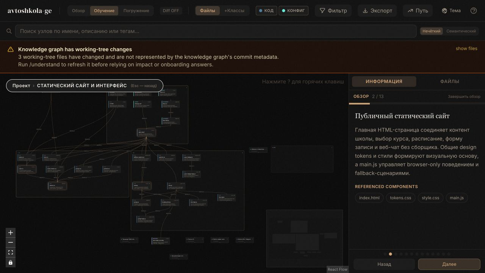

# Итог карты проекта, 2026-10-27

Автошкола на русском языке в Тбилиси: статический сайт с тренажёрами билетов ПДД и Telegram-ботом для заявок на Cloudflare Workers с D1. Note: this project has over 100 source files; consider scoping analysis to a subdirectory for faster results.

Покрыто 856 из 856 файлов согласованного состава. Узлов 1300, связей 2719; слоев 8, шагов 13.

Точка входа: [памятка агента](../docs/agent-guide.md). Граф: [knowledge-graph.json](knowledge-graph.json). Полная проверка: [validation.json](validation.json).

## Категории файлов

- docs: 133
- infra: 1
- config: 22
- script: 6
- markup: 27
- code: 660
- data: 7

530 WebP-ресурсов входят в scanner-категорию code, но в графе имеют тип resource. Это учет файлов, без анализа содержимого изображений.

## Узлы

- file: 161
- function: 381
- endpoint: 16
- class: 29
- pipeline: 1
- table: 23
- document: 133
- config: 23
- schema: 2
- service: 1
- resource: 530

## Связи

- contains: 444
- exports: 224
- calls: 275
- imports: 148
- tested_by: 79
- depends_on: 971
- reads_from: 32
- defines_schema: 18
- migrates: 4
- related: 115
- documents: 294
- configures: 35
- deploys: 2
- triggers: 57
- serves: 1
- writes_to: 20

## Слои

- Статический сайт и интерфейс: 33 файловых узлов.
- Тренажер ПДД и билеты: 551 файловых узлов.
- Worker API и Telegram: 43 файловых узлов.
- Схема D1 и миграции: 23 файловых узлов.
- Python-сервис чата: 19 файловых узлов.
- Данные и генераторы: 36 файловых узлов.
- Тесты и CI: 64 файловых узлов.
- Документация и спецификации: 121 файловых узлов.

## Маршрут

1. Назначение и правила
2. Публичный статический сайт
3. Тренировка и экзамен
4. Банк билетов
5. Публичный Worker API
6. Транзакции и схема D1
7. Telegram и очереди
8. Защищенная админка
9. Сборка Python-чата
10. Знания и расписание чата
11. Цепочка генераторов
12. Регрессии и CI
13. Спеки и карта проекта

## Проверка и ограничения

Проверены bundled scan/import/extraction/merge, независимое ревью, строгая core schema, все ссылки графа, назначения слоев, маршрут, диапазоны строк и отсутствие запрещенной типографики. Baseline содержит 856 файлов.

- 31 узлов без связей; это не ошибка покрытия файлов.
- Статический анализ локального кода; production и платные API не проверялись.
- WebP представлены ресурсами без анализа содержимого изображений.
- Полнота динамических вызовов и runtime-связей не гарантируется.
- Действуют согласованные и встроенные исключения scanner.
- Автоматическое обновление выключено.
- Prebuilt viewer v2.9.6 недоступен по release URL (404); установленный локальный dashboard запущен успешно.
- Viewer показывает dirty-warning для трех незакоммиченных файлов документации. Их актуальное содержимое включено в анализ и fingerprints; commit не создавался.

Приложение не менялось. Тесты приложения и live API не запускались. Commit, push и deploy не выполнялись.

