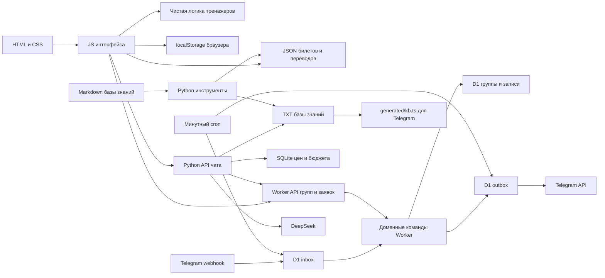

# Карта проекта для агента

Проверено по локальному коду 2026-10-27, базовый commit
`1de5a269a92b792f8f95cbfdbc93a14ddff389cc`. Это навигация по устройству
проекта, а не подтверждение текущего состояния production. Перед работой
прочитайте [AGENTS.md](../AGENTS.md) и [CLAUDE.md](../CLAUDE.md), проверьте
`git status` и сопоставьте документы с измененным кодом. Незакоммиченные
правки других задач сохраняйте.

## Что открыть сначала

1. Этот файл и обязательные инструкции выше.
2. [README](../README.md) для назначения продукта. Описания старых способов
   отправки заявок и исторические отчеты в README проверяйте по коду.
3. [Граф](../.ua/knowledge-graph.json): `nodes` описывают файлы и символы,
   `edges` связывают их, `layers` разделяют подсистемы, `tour` задает маршрут.
4. Спецификацию нужной функции в [specs](../specs/) и связанный `.plan-*.md`.
   Галочка старого плана не доказывает готовность живого сервиса.
5. Тесты нужного контура и его точку входа из таблицы ниже.

## Независимые контуры

| Контур | Вход и ключевые файлы | Где работает, состояние |
|---|---|---|
| Статический сайт | `index.html`, `voprosy/index.html`, `js/main.js`, `css/` | GitHub Pages; без сборщика и серверного JS |
| Каталог и тренажеры ПДД | `bilety/`, `js/ticket-bank.js`, `js/exam.js`, `js/training.js`, `js/ticket-catalog.js` | Браузер; прогресс и сессия локальны |
| Расписание, запись и Telegram | `bot/src/index.ts`, `booking-api.ts`, `router.ts` | Cloudflare Worker; общая D1, отдельные флаги доступности |
| Чат школы | `chat_agent/wsgi.py`, `http_app.py`, `harness.py` | Python WSGI/Gunicorn; SQLite фактов и бюджета |
| Импорт и генерация | `tools/` | Python; отдельные зависимости и тесты |
| Процесс разработки | `.specify/`, `specs/`, `.agents/skills/`, `.github/workflows/ci.yml` | Spec Kit, спецификации и CI, не runtime сайта |



## Где менять нужное поведение

| Задача | Начните здесь | Связанная проверка |
|---|---|---|
| Главная, цены, визуальное оформление | `index.html`, `css/tokens.css`, `css/style.css`, `css/course-choice.css` | `tests/browser/course-choice.spec.js`, тесты версий ресурсов |
| Расчет стоимости курса | `js/course-budget-logic.js`, затем `js/course-budget.js` | `js/tests/course-budget.test.js` |
| Экзамен, лимиты ошибок и времени | `js/exam-logic.js`, затем `js/exam.js` | `js/tests/exam-logic.test.js` |
| Фильтры, прогресс и миссии | `js/training-logic.js`, затем `js/training.js` | `js/tests/training-logic.test.js` |
| Продолжение сессии | `js/training-session.js`, параметры URL в `training.js` | `js/tests/training-session.test.js`, `tests/browser/training-start.spec.js` |
| Каталог, темы и номера билетов | `js/ticket-catalog-logic.js`, `js/ticket-catalog.js`, `tools/build_topic_pages.py` | `js/tests/ticket-catalog.test.js`, `tools/tests/test_build_topic_pages.py` |
| Переводы и состав банка | `js/ticket-bank.js`, `data/*.json`, `tools/parse_tickets.py`, `tools/audit_tickets.py` | Тесты ticket-bank и tools; `docs/tickets-known-issues.md` |
| Виджет чата, приглашение и история | `js/chat.js`, `js/chat-logic.js`, `js/chat-api.js`, `css/chat.css` | `js/tests/chat-*.test.js`, `tests/browser/chat-invitation.spec.js` |
| Качество ответов модели | `chat_agent/harness.py`, `knowledge.py`, `facts.py`, `provider.py` | `chat_agent/tests/`; платный `eval_answers.py` отдельно |
| Расписание на сайте | `js/groups.js`, `js/groups-logic.js`, `bot/src/groups.ts`, `rolling-groups.ts` | `js/tests/groups.test.js`, тесты Worker расписания |
| Отправка записи с сайта и чата | `js/booking-form.js`, `bot/src/booking-api.ts`, `bookings.ts`, `booking-commands.ts` | `js/tests/booking-form.test.js`, `tests/browser/group-booking.spec.js` |
| Telegram диалог и доставка | `bot/src/router.ts`, `conversation.ts`, `inbox.ts`, `outbox.ts`, `telegram.ts` | `bot/test/` |
| Доступ сотрудников | `bot/src/admin-auth.ts`, `bot/admin/`; отдельно `chat_agent/access.py`, `static/` | Worker auth-тесты и `tests/browser/admin-booking.spec.js` |
| Аналитика и партнерские переходы | `js/analytics.js`, `js/affiliate-analytics.js` | `js/tests/affiliate-analytics.test.js` |
| Индексация и тексты для LLM | `tools/build_llms_full.py`, `tools/update_sitemap.py` | Соответствующие тесты tools |

## Источники данных и границы записи

- `data/tickets-b-ru.json` хранит снимок 921 вопроса стороннего каталога.
  51 русский перевод накладывается из трех `eco-ru-*.json` при загрузке.
  `withdrawn-tickets.json` и поле `withdrawn` нужны для аудита, сейчас они
  не исключают вопросы из тренировки. Сверка текущего официального банка
  после авторизации остается отдельной задачей.
- `data/ticket-topics.json` связывает вопросы с темами; изображения лежат
  в `data/tickets/images/`. Нельзя менять правильный ответ ради прохождения
  теста или считать сторонний источник официальным подтверждением.
- Ключ прогресса: `avtoshkola-progress-v1`; снимок тренировки:
  `avtoshkola-training-session-v1`. Снимок проверяет сигнатуру банка.
  Миграция формата хранения должна сохранять допустимый старый прогресс.
- Канонические группы и групповые записи находятся в Worker+D1. Мутации
  проходят через атомарные команды с revision, идемпотентностью и audit.
  Не добавляйте прямые writers в Python, UI или cron.
- Python `GroupClient` при `BOOKING_API_URL` только читает расписание.
  При общем источнике групп прежний HTTP writer возвращает 410.
  Каталог цен Python и D1
  расписания решают разные задачи, не объединяйте их по названию `catalog`.
- Markdown в `baza-znaniy/` служит исходным материалом TXT в `dlya-bota/`;
  `tools/build_kb_txt.py` собирает TXT, `bot/scripts/build-kb.mjs` собирает
  `bot/src/generated/kb.ts`. Последний файл не редактируют вручную.
  Python ищет только по тематическим TXT 00-05, исключая служебные
  блоки и цены; Telegram собирает разделы 00-06. Полные сводки и файлы
  07-09 не нужно передавать модели по соседству с разрешенными файлами.
- `llms-full.txt`, `sitemap.xml` и страницы тем имеют генераторы. Даты
  обновления вычисляются из git, а не назначаются вручную.

## API и конфигурация

| Клиент | Контракт | Граница |
|---|---|---|
| Сайт, Python reader | `GET /api/v1/groups` Worker | `PUBLIC_SCHEDULE_ENABLED` или включенная запись; ответ сообщает `booking_enabled` |
| Форма сайта и чата | `POST /api/v1/bookings` Worker | Origin allowlist, Turnstile, `Idempotency-Key`, согласие, revision группы |
| Админка групп | `/admin/`, `/api/admin/v1/*` Worker | Access JWT, allowlist, origin и CSRF; assets обслуживаются после Worker |
| Telegram | `POST /webhook/<секрет>` Worker | Независимые секрет пути и заголовка, durable inbox до ответа 200 |
| Ответ чата | `POST /api/chat` Python | Origin, размеры, rate limit, ограниченная параллельность |
| Каталог цен для виджета | `GET /api/catalog` Python | Проверка Origin, без ограничений тела и параллельности POST чата |
| Health чата | `GET /health` Python | Отвечает до проверки Origin |
| Прежняя админка цен | `/admin/`, `/api/admin/*` Python | Отдельный Access; не путать с Worker API v1 |

В текущих `index.html` и `voprosy/index.html` заданы публичный origin
`https://booking.avtoshkola.ge` и адрес чата
`https://vps-apds.tail9c66b0.ts.net:10000`. Это проверка исходников,
не live health и не доказательство включенного приема записей. Флаги
Worker и секреты нельзя вывести из HTML или `wrangler.toml`.

В `bot/wrangler.toml` нет `[vars]` намеренно: конфигурация задается secrets,
чтобы deploy не затирал ее. `run_worker_first = true` защищает админские
assets. Без настроек соответствующий контур закрыт. Чтение расписания,
запись, автоматическое пополнение групп и Telegram включаются независимо.

`chat_agent/wsgi.py` собирает зависимости. `provider.py` ограничивает
месячный бюджет до $5 через общий SQLite ledger и блокирует вызовы после
2026-11-16 до проверки тарифов. Это дата в локальном коде, а не новое
подтверждение тарифов. Бюджет является прикладным guard одной постоянной
базы `budget.sqlite3`: ее смена или удаление обнуляет учет, другие
потребители API-ключа не покрыты. Это не лимит списаний со всего аккаунта.
Не запускайте live eval как обычный бесплатный тест.
Сервисный шаблон: `chat_agent/deploy/avtoshkola-chat.service`; он описывает
Gunicorn на loopback и отдельное состояние, но не доказывает установку.

## Проверки и запуск

Из корня проекта:

```bash
npm test
(cd bot && npm test && npm run typecheck)
.venv/bin/python -m pytest tools -q
.venv/bin/python -m pytest chat_agent/tests -q
npm run test:browser
```

Команды взяты из инструкций, manifests и CI. CI запускает site, browser,
bot и tools отдельными jobs, причем tools включает `chat_agent/tests`.
Для этой карты проверяется сама документация и структура графа; перечисление
команд не означает, что тесты приложения были повторно выполнены.

Статический preview: `python3 -m http.server 8765 --bind 127.0.0.1`.
Browser runner сам занимает порт 8881 и проверяет 1280, 390 и 320 px.
Fixture-тесты не подтверждают живую доставку Telegram, Access, Turnstile
или качество ответа настоящей модели. Не отправляйте реальные заявки для
проверки интерфейса без соответствующего разрешения.

## Ошибки, которых стоит избегать

- Правила экзамена, прогресс и фильтры меняются в `*-logic.js`, DOM в
  интерфейсных файлах. Иначе проверки чистой логики перестают покрывать их.
- При изменении JS/CSS обновляйте ручной `?v=` во всех подключениях,
  включая импорты модулей и вложенные HTML. Есть тест согласованности версий.
- D1 меняется миграциями в `bot/migrations/`; перед production миграцией
  нужен backup. Не исправляйте примененную схему только локальным SQL.
- Новое поле персональных данных должно попасть в `bot/src/cleanup.ts`.
  Имена и телефоны нельзя класть в URL/логи; поиск админки использует POST.
- Outbox допускает повтор внешней доставки после crash. Успех Telegram API
  не означает прочтение сотрудником. Не обещайте exactly-once доставку.
- Расписание пополняется `rolling-groups.ts` с отдельным флагом; переносы
  и отмены календарных слотов нужно сохранять. Подробности в specs/012.
- Содержимое `!notes` приватно, игнорируется Git и исключено из карты.
  Не копируйте его, секреты или данные учеников в граф и документацию.

## Спецификации и продолжение

`specs/001` описывает чат; `002`, `004`, `005`, `006` учебные сценарии;
`003` и `009` партнеров; `007` и `008` визуальные изменения; `010` групповую
запись; `011` входные сценарии главной; `012` выбор курса и повторяемые
старты; `013` приглашение чата. Уточняйте точное название по каталогу.
Конституция и шаблоны процесса находятся в `.specify/`.

После изменения архитектуры обновите этот файл и граф через установленный
навык `understand-anything:understand`, сохранив `.ua/.understandignore`.
Правила обновления и ограничения карты: [.ua/README.md](../.ua/README.md).
Не устанавливайте Claude hooks в Codex и не включайте автоматизацию без
проверки поддержки. Автообновление этой карты сейчас выключено.
